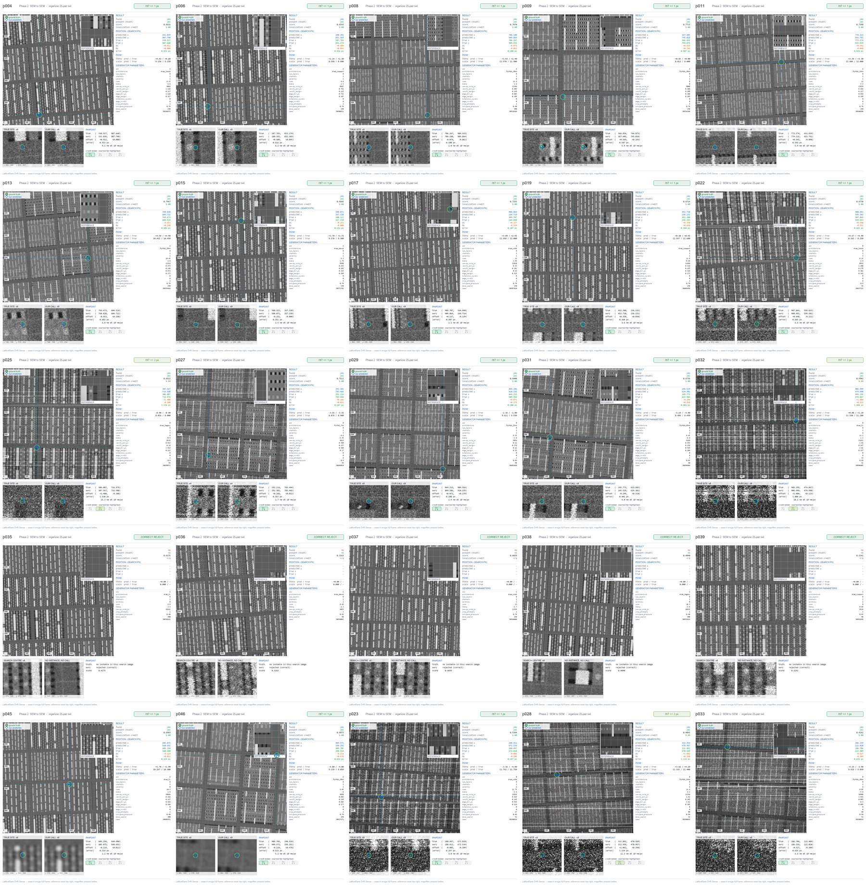

# LatticeRank Drift-Sense

CPU-only image registration for the SEMICON India 2026 Drift-Sense problem. Given a reference pattern and a search SEM image, each solver reports where the reference sits in the search image, its rotation and scale, and whether it is present at all.

**Built for:** SEMICON India Hackathon 2026, Problem Statement 2 (Applied Materials Drift-Sense: navigation-error recovery for wafer inspection tools)

**Team:** Volt Visionaries (Rhudhresh R, Sowdeswari S, Amoga A, Dhruv D Mehta), Saveetha Engineering College

**Result:** Grand finalist (Top 5) for the problem statement, Grand Finale at Yashobhoomi (IICC), New Delhi, 17–19 Sep 2026

**Stack:** Python 3.11+ · NumPy · SciPy · Pillow · OpenCV (headless) · gdstk (Phase 3)



## What it does

Two submissions, judged separately. Each folder is self-contained, with its own README, pinned requirements and tests.

| | Phase 2: SEM to SEM | Phase 3: CAD to SEM |
|---|---|---|
| Reference | SEM image, 1000×1000 px at 1 nm/px | GDSII design file for the same site |
| Search image | SEM image | SEM image |
| Entry point | `phase_2/register.py` | `phase_3/phase3.py` |
| Main method | Scharr edge maps, SIFT and spectral pose hypotheses, edge-correlation search, multi-verifier acceptance | Rasterized GDS layers, SEM brightness fitted per layer at each candidate, edge agreement |
| Folder README | [phase_2/README.md](phase_2/README.md) | [phase_3/README.md](phase_3/README.md) |

Phase 3 changes only the reference. A design file carries no brightness, so Phase 3 keeps each GDS layer separate and estimates how each one appears in the SEM. The search image, the output format and the scoring match Phase 2. Both phases rely on edges, because edges are what the design and the SEM share.

## Quick start

Run each phase from inside its own folder. `pairs.csv` is not in this repository; no dataset is stored here.

```bash
# Phase 2: SEM to SEM
cd phase_2
python -m pip install -r requirements.txt
python register.py --input pairs.csv --output predictions.csv

# Phase 3: CAD to SEM
cd ../phase_3
python -m pip install -r requirements.txt
python phase3.py --input pairs.csv --output predictions.csv
```

Both write one row per `pair_id` with this header:

```csv
pair_id,x,y,theta,scale,found,score
```

Rejected rows carry `x = y = theta = scale = 0`. `score` is clipped to `[0, 1]`. The run uses no network access.

Phase 2 reads `pair_id,search_path,reference_path`. Phase 3 reads `pair_id,search_path,reference_gds_path,search_gds_path` (optional), and it ignores the training-only `reference_sem_path` and `params_json_path` columns.

## How it works

Phase 2 (`phase_2/`):

- Builds Scharr edge maps for the search and reference images.
- Proposes poses from SIFT with affine RANSAC, from spectral rotation and scale estimates, and from edge searches.
- Correlates the warped reference edge map over the search image and keeps several peaks, including remote periodic aliases.
- Refines `(x, y, theta, scale)` together, then verifies the winner against a remote runner-up.
- Abstains when the independent verifiers do not agree.

Phase 3 (`phase_3/`):

- Parses the GDS reference and rasterizes each layer separately.
- Proposes candidate locations from the CAD boundaries and from each layer.
- Fits a regularized SEM contrast per layer at each candidate. A layer may fit to zero.
- Scores edge agreement, appearance agreement and geometric support, then rejects candidates without enough SEM evidence.

## Project structure

```
phase_2/   Phase 2 submission: register.py, driftforge/ solver modules, tests/, assets/
phase_3/   Phase 3 submission: phase3.py, io_contract.py, driftforge/ CAD and SEM modules, tests/, assets/
```

Each folder's tests run with `python -m pytest tests -q` from inside that folder (pytest is not in the pinned requirements).

## Roadmap

Results on the organizer sets released to the team. These are measurements on those sets, not claims about the unseen jury set.

| | Phase 2 (25-pair v2 cut) | Phase 3 (25-pair CAD2SEM set) |
|---|---|---|
| Present / absent | 20 / 5 | 23 / 2 |
| Median localization error | 0.54 px (worst 1.81 px) | 0.31 px (worst 0.68 px) |
| Rejection F1 on `found` | 1.000, 0 false positives | 1.000 (TP 23, FP 0, FN 0, TN 2) |
| AUC of `score` | 0.940 | 0.978 |
| Runtime | about 1.5 s per pair on CPU | median 0.35 s per pair (image-only path) |

- Both folders pass the 11 submission checks listed in their READMEs: self-contained folder, pinned dependencies, `--help`, blind-split run, no network, exact header, one row per pair, no duplicates, finite values, deterministic output.
- Phase 3 reports `theta = 0` and `scale = 10` as fixed values. That matches the measured set, but it would lose the pose points on a set with real rotation. The Phase 3 README records this as a known limit.
- Phase 3 applies a fixed x-centre correction (`CENTRE_X_CALIBRATION` in `phase_3/driftforge/cad_edges.py`) measured on the 25-pair set.

## Relation to LatticeRank

[LatticeRank](https://github.com/RHUDHRESH/LatticeRank) holds the synthetic SEM data generator (DriftForge), the classical NCC baseline and the release-gate audit. This repository holds the two submitted solvers.

---

Built by [Rhudhresh R](https://github.com/RHUDHRESH)
